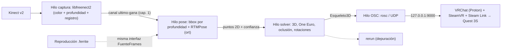
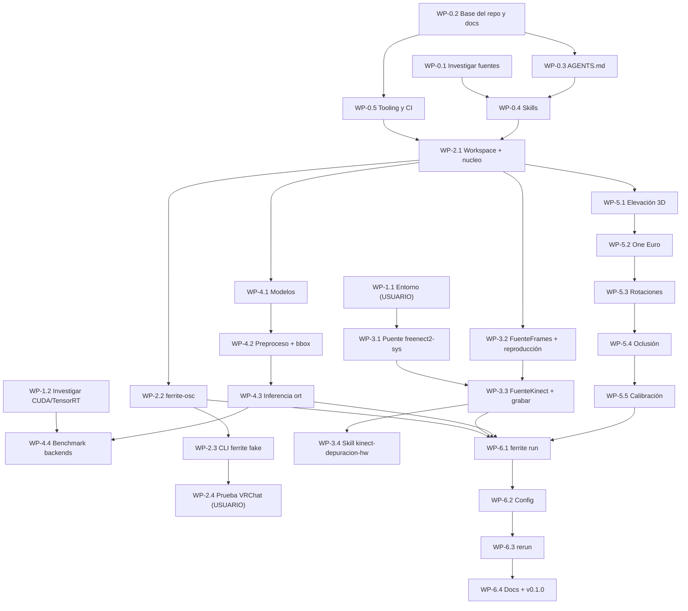

# FerriteVR: plan maestro v3 (para delegar en subagentes)

> Documento de traspaso. Cada **paquete de trabajo (WP)** está pensado para que un subagente (Gemini 3.8 Flash, medium) lo ejecute **sin contexto previo**: incluye dependencias, archivos, tareas, criterios de aceptación y verificación. Ejecuta los WP **en el orden del grafo** y **un WP por subagente**.

---

## 1. Resumen del proyecto

**FerriteVR** es un programa nativo de Linux escrito en Rust que convierte un **Kinect v2 (Xbox One)** en *full body tracking* para **VRChat**, enviando trackers por **OSC**. El usuario juega con unas **Meta Quest 3S vía Steam Link** en **Nobara 44 (KDE Wayland)**, con un Core Ultra 5 225F, una RTX 3060 12 GB, 16 GB de RAM y Ethernet gigabit.

### Decisiones cerradas

| Tema | Decisión |
|---|---|
| Alcance v1 | Solo VRChat por OSC (el driver OpenVR queda para el futuro) |
| Idioma | **Todo en español**: docs, rustdoc, comentarios, commits e **identificadores** (ASCII, sin tildes ni `ñ`; ver la sección 3) |
| Licencia | `MIT OR Apache-2.0` |
| Git | Commits pequeños directos a `dev`; merge a `main` + tag `vX.Y.Z` solo en versiones estables |
| Cómputo | Backends CPU / CUDA / TensorRT; el **predeterminado se elige por benchmark con VRChat + Steam Link en marcha** (WP-4.4) |
| Algoritmo | Pose 2D (**RTMPose Halpe26**, Apache-2.0) + **profundidad medida** del Kinect → 3D. **Prohibido YOLO de Ultralytics (AGPL)** |
| Hardware | El Kinect llega en ~1 semana (el adaptador ya está). Hasta entonces: modo `fake` y grabaciones |

### Arquitectura



- **Canales "último gana":** si una etapa se atrasa, se descartan frames viejos en lugar de acumular latencia.
- **Presupuesto:** < 25 ms del sensor al paquete OSC (el sensor entrega 30 FPS, es decir, un frame cada 33 ms).
- **Rango útil del Kinect:** 0.5–4.5 m. La oclusión al ponerse de espaldas se **mitiga**, no se elimina.

### Estructura objetivo del repositorio

```
FerriteVR/
├── Cargo.toml                    # workspace
├── AGENTS.md                     # rules del agente (raíz)
├── README.md  CHANGELOG.md  CONTRIBUTING.md  LICENSE-MIT  LICENSE-APACHE
├── rustfmt.toml  clippy.toml  deny.toml  _typos.toml  .editorconfig
├── .agents/skills/{rust-guidelines,ferrite-verificar,ferrite-docs,vrchat-osc,kinect-depuracion-hw}/
├── .githooks/pre-commit
├── .github/workflows/ci.yml
├── scripts/{verificar.sh,descargar-modelos.sh}
├── config/ferrite.ejemplo.toml
├── docs/{README.md,tutoriales/,guias/,referencia/,explicacion/,adr/}
├── crates/
│   ├── ferrite-nucleo/           # tipos, espacios de coordenadas, config
│   ├── ferrite-osc/              # emisor OSC para VRChat
│   ├── ferrite-sensor/           # trait FuenteFrames, reproducción, Kinect (feature)
│   ├── ferrite-freenect2-sys/    # puente cxx con libfreenect2 (único crate con unsafe)
│   ├── ferrite-pose/             # inferencia ONNX (ort)
│   └── ferrite-solver/           # elevación 3D, filtros, oclusión, rotaciones, calibración
└── apps/ferrite/                 # binario CLI
```

---

## 2. Contrato para todos los subagentes

> [!IMPORTANT]
> Pega esta sección **completa** al inicio de cada prompt de subagente.

1. **Repo:** `~/proyectos/FerriteVR`, rama **`dev`**. Nunca hacer commit a `main`, nunca usar `git push --force` y nunca reescribir el historial.
2. **Sin `sudo`.** Si un paso necesita privilegios, se escribe el comando en el reporte final para que lo ejecute el usuario y el subagente se detiene.
3. **Antes de escribir código, lee** `AGENTS.md` y las skills de `.agents/skills/` que apliquen.
4. **No inventes APIs.** Las versiones de crates se fijan con `cargo add <crate>@<versión>`. Antes de usar una API, verifícala en el código fuente de esa versión (`~/.cargo/registry/src/*/<crate>-<versión>/`) o con `cargo doc --open`. Esto es **crítico** con `ort`, `cxx`, `rosc` y `rerun`, que cambian entre versiones.
5. **Alcance cerrado:** solo se tocan los archivos del WP. Si hace falta algo fuera del alcance, se reporta y no se hace.
6. **Definition of Done** (debe cumplirse en todos los WP):
   - `./scripts/verificar.sh` en verde (a partir del WP-0.5; antes, `cargo build` y `cargo test` si aplican).
   - Tests nuevos para la lógica nueva.
   - Rustdoc en español en todo elemento público.
   - Entrada en `CHANGELOG.md` bajo `[Sin publicar]` si cambia el comportamiento.
   - ADR nuevo en `docs/adr/` si se toma una decisión de arquitectura.
7. **Commits:** pequeños y atómicos, con formato [Conventional Commits](https://www.conventionalcommits.org/es/) y descripción en español, en imperativo. Ejemplo: `feat(osc): agrega envío de trackers en un único bundle`. Los tipos (`feat`, `fix`, `docs`, `test`, `refactor`, `chore`, `ci`) se dejan en inglés porque son parte de la especificación.
8. **Reporte final** del subagente: archivos creados o modificados, commits (hash + mensaje), salida resumida de la verificación, desviaciones del plan y pendientes para el usuario.

### Plantilla de prompt para el subagente

```text
Eres un ingeniero senior de Rust trabajando en FerriteVR.
<CONTRATO: pegar la sección 2 completa>
<CONTEXTO: pegar la sección 1 (resumen) completa>
Tu tarea es el paquete de trabajo siguiente. Hazlo completo, verifica y reporta:
<PEGAR EL WP-x.y COMPLETO>
```

---

## 3. Convenciones de código (resumen; la versión oficial vive en `AGENTS.md`)

- **Identificadores en español, solo ASCII:** `Articulacion`, `Esqueleto3D`, `pos_cadera`, `anio`. Se aplica con el lint `non_ascii_idents = "deny"`. Los nombres de crates siguen el patrón `ferrite-*`.
- **Errores:** `thiserror` en las librerías y `anyhow` solo en `apps/`. Sin `unwrap`/`expect` fuera de los tests.
- **`unsafe`:** solo en `ferrite-freenect2-sys`, siempre con un comentario `// SEGURIDAD:` que explique el invariante.
- **Tiempo real:** sin asignaciones por frame en el camino caliente (se reutilizan buffers), sin E/S ni bloqueos en los hilos del pipeline y con canales "último gana".
- **Espacios de coordenadas tipados con newtypes:** `PosKinect` (mano derecha) y `PosUnity` (mano izquierda, Y arriba). Nunca se usa `Vec3` "desnudo" en las APIs públicas que crucen espacios.

---

## 4. Grafo de paquetes de trabajo



**Paralelizables:** WP-0.1 ∥ WP-0.2; WP-1.1 y WP-1.2 en cualquier momento; tras WP-2.1, las ramas 2.x, 3.2, 4.x y 5.x pueden avanzar en paralelo (todas trabajan sobre `dev` con commits atómicos y archivos distintos).

> [!WARNING]
> Si lanzas subagentes en paralelo sobre el mismo checkout, **coordina los archivos compartidos** (`Cargo.toml` raíz, `CHANGELOG.md`). Para evitar conflictos, lánzalos de forma secuencial o con `Workspace: "branch"` y fusiona después.

---

## 5. Paquetes de trabajo

### F0: Gobernanza

#### WP-0.1 Investigación de skills y rules · *subagente de solo lectura (research)*
- **Depende de:** nada.
- **Tareas:**
  1. Evaluar estas fuentes: Microsoft Pragmatic Rust Guidelines (`https://microsoft.github.io/rust-guidelines/agents/all.txt`), Rust API Guidelines, Conventional Commits, Keep a Changelog, SemVer, Diátaxis, MADR, documentación OSC Trackers de VRChat y repositorios comunitarios de skills de Rust (`rust-skills`, `lang-guidelines`).
  2. Para cada fuente registrar: autoridad, licencia, fecha/versión, tamaño, relevancia y **riesgos** (instrucciones peligrosas o desactualizadas).
  3. Extraer de la documentación de VRChat las direcciones OSC de trackers, unidades, ejes, formato de rotación y el comportamiento del tracker `head` (alineación), **citando la URL**.
- **Entregable:** el texto completo de `docs/explicacion/herramientas-agente.md` y de `docs/referencia/vrchat-osc-trackers.md`, devueltos en el reporte (como es de solo lectura, el WP-0.4 los escribe).
- **Aceptación:** cada fuente tiene su veredicto *adoptar / inspiración / descartar* con justificación. No se recomienda instalar nada con `npx` sin revisión.

#### WP-0.2 Base del repositorio y documentación
- **Depende de:** nada.
- **Archivos:** `README.md` (renombrar desde `README.MD` con `git mv`), `LICENSE-MIT`, `LICENSE-APACHE` (textos oficiales), `CHANGELOG.md`, `CONTRIBUTING.md`, `.editorconfig`, `.gitignore` (`/target`, `*.ferrite`, `/modelos/*.onnx`), `docs/README.md`, `docs/{tutoriales,guias,referencia,explicacion}/.gitkeep` y `docs/adr/`.
- **`CHANGELOG.md`:** formato Keep a Changelog en español (`## [Sin publicar]`, `### Agregado`, `### Cambiado`, `### Corregido`, `### Eliminado`).
- **`CONTRIBUTING.md`:** flujo git (commits a `dev`, `main` solo para versiones), Conventional Commits, Definition of Done y cómo activar los hooks (`git config core.hooksPath .githooks`).
- **ADRs (formato MADR, en español):**
  - `0000-plantilla.md`
  - `0001-workspace-rust.md`
  - `0002-vrchat-osc-primero.md`
  - `0003-pose-2d-mas-profundidad.md`
  - `0004-rtmpose-por-licencia.md`
  - `0005-licencia-dual-mit-apache.md`
  - `0006-backend-de-computo-por-benchmark.md` (estado *propuesto*; se cierra en el WP-4.4)
  - `0007-idioma-espanol.md`
  - `0008-flujo-git-dev-main.md`
- **Aceptación:** los ADRs tienen contexto, opciones, decisión y consecuencias, basados en la sección 1 de este plan. `docs/README.md` enlaza todo.
- **Commits:** `docs: agrega licencias, changelog y guía de contribución`; `docs(adr): registra decisiones iniciales de arquitectura`.

#### WP-0.3 Rules del agente (`AGENTS.md`)
- **Depende de:** WP-0.2.
- **Archivo:** `AGENTS.md` en la raíz (**objetivo < 6 KB**, sin frontmatter).
- **Contenido obligatorio:**
  - Qué es el proyecto (3 líneas).
  - Mapa de crates y responsabilidades.
  - Comandos canónicos (`./scripts/verificar.sh`, `cargo run -p ferrite -- fake`).
  - Las convenciones de la sección 3, la Definition of Done y las reglas de git del contrato.
  - **"Nunca ejecutar `sudo`".**
  - Lista de las skills disponibles y cuándo usarlas.
- **Aceptación:** conciso, sin repetir prácticas genéricas de Rust (esas van en la skill `rust-guidelines`). Los `AGENTS.md` anidados **no** se crean aquí: los crean el WP-2.2 (osc) y el WP-3.1 (sys).
- **Commit:** `docs(agentes): agrega reglas del proyecto en AGENTS.md`.

#### WP-0.4 Skills del workspace
- **Depende de:** WP-0.1 (veredictos y textos) y WP-0.3.
- **Formato:** `.agents/skills/<nombre>/SKILL.md` con frontmatter YAML (`name` en minúsculas con guiones; `description` en tercera persona que diga **qué** hace y **cuándo** usarla). El `SKILL.md` debe ser breve; el material extenso va en `references/`.
- **Skills:**

| Skill | Contenido |
|---|---|
| `rust-guidelines` | Resumen en español de los puntos clave + `references/pragmatic-rust-guidelines.txt` vendorizado, con encabezado de URL, fecha de descarga y licencia |
| `ferrite-verificar` | Cómo correr `scripts/verificar.sh`, cómo interpretar los fallos típicos (clippy, deny, typos) y cómo corregirlos |
| `ferrite-docs` | Matriz Diátaxis ("qué documento toco según el cambio"), cómo escribir una entrada de changelog, cómo numerar y redactar un ADR |
| `vrchat-osc` | `references/osc-trackers.md` con el contenido de `docs/referencia/vrchat-osc-trackers.md` del WP-0.1 |

- **Además:** escribir `docs/explicacion/herramientas-agente.md` y `docs/referencia/vrchat-osc-trackers.md` con los textos del WP-0.1.
- **Aceptación:** frontmatter válido. Ninguna skill contiene instrucciones para usar `sudo`, hacer `push` a `main` ni descargar o ejecutar código no revisado.
- **Commit:** `docs(agentes): agrega skills del proyecto`.

#### WP-0.5 Tooling de calidad y CI
- **Depende de:** WP-0.2. Para usar `cargo-deny` y `typos` en local, el usuario debe haber completado el paso de `cargo install` del WP-1.1; si faltan, el script los omite con un aviso.
- **Archivos:**
  - `rustfmt.toml` (`edition = "2024"`, `max_width = 100`).
  - `clippy.toml`.
  - `deny.toml`: licencias permitidas MIT, Apache-2.0, BSD-2/3, ISC, Zlib, Unicode-3.0, MPL-2.0; **GPL/AGPL denegadas**; advisories activados.
  - `_typos.toml`: hay que configurarlo para el español. `typos` está orientado al inglés, así que se añaden falsos positivos en `[default.extend-words]`; si el ruido es excesivo, se limita a `extend-exclude` sobre `docs/` y se documenta.
  - `scripts/verificar.sh`: `set -euo pipefail`; ejecuta fmt `--check`, `clippy --workspace --all-targets -- -D warnings`, `test --workspace`, `RUSTDOCFLAGS=-Dwarnings cargo doc --no-deps`, `cargo deny check` y `typos`, y se salta las herramientas ausentes mostrando un aviso.
  - `.githooks/pre-commit`: fmt, clippy y typos.
  - `.github/workflows/ci.yml`: Ubuntu, toolchain estable, caché, `verificar.sh` y **lychee** sobre `docs/` y `*.md`. Los crates de hardware se excluyen mediante features (sin `kinect` ni `cuda` en la CI).
- **Aceptación:** `./scripts/verificar.sh` termina en 0 con el repo actual (todavía sin crates, el script detecta la ausencia de workspace y solo ejecuta deny/typos/lychee si aplican). Un archivo `.rs` mal formateado es rechazado por el hook.
- **Commit:** `ci: agrega verificación local, hooks y flujo de CI`.

---

### F1: Entorno

#### WP-1.1 Instalación de dependencias · **USUARIO (requiere `sudo`)**
```bash
sudo dnf install cmake libusb1-devel turbojpeg-devel ocl-icd-devel mesa-libGL-devel glfw-devel clang-devel
cargo install --locked cargo-deny typos-cli
git clone https://github.com/OpenKinect/libfreenect2.git ~/src/libfreenect2
cd ~/src/libfreenect2 && mkdir build && cd build
cmake .. -DCMAKE_INSTALL_PREFIX=/usr/local -DENABLE_CXX11=ON
make -j10 && sudo make install
sudo cp ../platform/linux/udev/90-kinect2.rules /etc/udev/rules.d/
sudo udevadm control --reload-rules && sudo udevadm trigger
```
- **Verificación:** `PKG_CONFIG_PATH=/usr/local/lib/pkgconfig pkg-config --modversion freenect2`.
- **Si la compilación falla** (por ejemplo, con GCC 16 o CMake 4): lanza un subagente con el log del error para que proponga parches mínimos y los documente en `docs/guias/compilar-libfreenect2.md`.
- **Cuando llegue el Kinect:** conéctalo a un puerto USB 3 directo (sin hub), ejecuta `./bin/Protonect gl` y comprueba que muestra color, IR y profundidad; `lsusb -t` debe mostrarlo a 5000M.

#### WP-1.2 Investigación de CUDA / cuDNN / TensorRT en Nobara 44 · *research*
- **Depende de:** nada. Solo es necesario antes del WP-4.4.
- **Tareas:**
  1. Determinar la vía más limpia de instalación (paquetes de Nobara o RPM Fusion frente al repositorio oficial de NVIDIA) compatible con el driver **595** ya instalado.
  2. Revisar las versiones que exige el crate `ort` (2.x) para sus execution providers CUDA y TensorRT.
  3. Revisar si los binarios precompilados que descarga `ort` incluyen CUDA/TensorRT, o si conviene usar `load-dynamic`.
- **Entregable:** el texto de `docs/guias/instalar-cuda-tensorrt.md` con los comandos exactos (para que los ejecute el usuario) y los riesgos (por ejemplo, conflictos con el driver de Nobara).

---

### F2: Workspace, núcleo y OSC

#### WP-2.1 Workspace + `ferrite-nucleo`
- **Depende de:** WP-0.4 y WP-0.5.
- **`Cargo.toml` raíz:** `resolver = "3"`, `members = ["crates/*", "apps/*"]`. En `[workspace.package]`: `edition = "2024"`, `license = "MIT OR Apache-2.0"`, `repository = "https://github.com/C-Rip/FerriteVR"`, `rust-version = "1.85"`. En `[workspace.dependencies]` se fijan con `cargo add` las versiones de `glam`, `rosc`, `crossbeam-channel`, `serde`, `toml`, `thiserror`, `anyhow`, `tracing`, `tracing-subscriber` y `clap`.
- **Lints del workspace:** `unsafe_code = "deny"`, `missing_docs = "warn"`, `non_ascii_idents = "deny"`; clippy `unwrap_used = "warn"` y `expect_used = "warn"`. Perfil release: `lto = "thin"`, `codegen-units = 1`, `debug = 1`.
- **`crates/ferrite-nucleo`:**
```rust
//! Tipos compartidos de FerriteVR: articulaciones, esqueletos y espacios de coordenadas.
use glam::{Quat, Vec3};

/// Posición en el espacio de la cámara Kinect (mano derecha, metros).
#[derive(Debug, Clone, Copy, PartialEq)]
pub struct PosKinect(pub Vec3);

/// Posición en el espacio de Unity/VRChat (mano izquierda, Y arriba, metros).
#[derive(Debug, Clone, Copy, PartialEq)]
pub struct PosUnity(pub Vec3);

/// Articulaciones expuestas como trackers.
#[derive(Debug, Clone, Copy, PartialEq, Eq, Hash)]
pub enum Articulacion { Cabeza, Pecho, Cadera, RodillaIzq, RodillaDer, PieIzq, PieDer, CodoIzq, CodoDer }

/// Pose de una articulación con su confianza (0..1).
#[derive(Debug, Clone, Copy)]
pub struct PoseArticulacion { pub posicion: PosUnity, pub rotacion: Quat, pub confianza: f32 }

/// Esqueleto completo de un frame.
#[derive(Debug, Clone)]
pub struct Esqueleto3D { pub marca_tiempo_us: u64, pub articulaciones: Vec<(Articulacion, PoseArticulacion)> }
```
- **Conversiones `PosKinect → PosUnity` y `Quat → Euler ZXY en grados` (convención de Unity):** el subagente **debe derivar y documentar** los ejes (el espacio de profundidad de libfreenect2 puede venir espejado horizontalmente; hay que verificarlo en el código fuente de `Registration::getPointXYZ`). Se implementan como funciones puras con tests de valores conocidos y `proptest` de ida y vuelta (tolerancia `1e-5`).
- **Aceptación:** `verificar.sh` en verde y doc-tests en las conversiones.
- **Commits:** `chore: inicializa workspace de cargo`; `feat(nucleo): agrega tipos de esqueleto y espacios de coordenadas`.

#### WP-2.2 `ferrite-osc`
- **Depende de:** WP-2.1. Leer la skill `vrchat-osc` antes de empezar.
- **API pública:**
  - `EmisorVrchat::nuevo(destino: SocketAddr) -> io::Result<Self>`
  - `enviar_frame(&self, &[MuestraTracker]) -> Result<(), ErrorOsc>`
  - `MuestraTracker { ranura: RanuraTracker, posicion: [f32; 3], euler_grados: [f32; 3] }`
  - `RanuraTracker::{Cabeza, Numerada(1..=8)}` con `direccion()`, que devuelve `/tracking/trackers/head` o `/tracking/trackers/N`.
- **Envío:** cada frame va en **un único `OscBundle`** con mensajes `{base}/position` y `{base}/rotation`.
```rust
fn mensaje_vec3(direccion: String, v: [f32; 3]) -> OscPacket {
    OscPacket::Message(OscMessage { addr: direccion, args: v.map(OscType::Float).to_vec() })
}
// dentro de enviar_frame:
// [mensaje_vec3(format!("{base}/position"), m.posicion), mensaje_vec3(format!("{base}/rotation"), m.euler_grados)]
```
- **Validación:** si la ranura numerada está fuera de 1..=8, se devuelve error (no se hace pánico).
- **`crates/ferrite-osc/AGENTS.md`:** convenciones de VRChat (metros, Y arriba, mano izquierda, Euler en grados, orden ZXY).
- **Tests:** integración con un `UdpSocket` receptor en `127.0.0.1:0` + `rosc::decoder`, verificando direcciones, número de mensajes y valores.
- **Commit:** `feat(osc): agrega emisor de trackers para VRChat`.

#### WP-2.3 CLI `ferrite` con el subcomando `fake`
- **Depende de:** WP-2.2.
- **`apps/ferrite`:** `clap` (derive), `tracing-subscriber` (`RUST_LOG`) y `anyhow`. Subcomando `fake --destino 127.0.0.1:9000 --hz 30`: genera un esqueleto sintético de **caminata en el sitio** (cadera a ~1.0 m, pies alternando con una sinusoide, rodillas coherentes) y lo envía a la frecuencia indicada, usando un *ticker* que no acumule deriva. Ctrl+C debe cerrar limpiamente (crate `ctrlc`).
- Deja declarados como `todo` documentado los subcomandos `run`, `grabar`, `reproducir` y `bench`, que devuelven un error claro de "no implementado".
- **Tests:** la generación sintética es determinista dado un instante `t`, y los pies nunca quedan por debajo de Y = 0.
- **Docs:** `docs/tutoriales/primera-prueba-con-vrchat.md`.
- **Commit:** `feat(cli): agrega modo fake con esqueleto sintético`.

#### WP-2.4 Prueba de punta a punta en VRChat · **USUARIO**
1. Abre Steam Link en la Quest 3S y lanza VRChat.
2. En VRChat, activa OSC (*Action Menu → Options → OSC → Enabled*).
3. Ejecuta `cargo run --release -p ferrite -- fake`.
4. Frente a un espejo, calibra el FBT en VRChat: las piernas del avatar deben caminar.
5. Anota en `docs/tutoriales/primera-prueba-con-vrchat.md` cualquier ajuste necesario.

---

### F3: Sensor Kinect

#### WP-3.1 `ferrite-freenect2-sys` (puente `cxx`)
- **Depende de:** WP-1.1 (libfreenect2 instalada) y WP-2.1.
- **Primero:** evaluar el crate `freenect2-rs`, revisando mantenimiento, cobertura de `Registration` y licencia. Si no sirve, crear un puente propio.
- **Shim C++** (`src/shim.cc` / `include/shim.h`):
  - `abrir_dispositivo()`, `iniciar()` y `detener()`.
  - `esperar_frames(timeout_ms) -> bool`.
  - `aplicar_registro()`, que copia en buffers de Rust la profundidad sin distorsión (512×424 `f32`, mm) y el color registrado (512×424 RGBA).
  - `intrinsecos_profundidad() -> {fx, fy, cx, cy}`.
- **`build.rs`:** usa `pkg-config` (`freenect2`, con fallback a `/usr/local/lib/pkgconfig`) y `cxx_build`. Todo se compila detrás de la feature `kinect`; sin ella, el crate queda vacío para que la CI pase.
- **Seguridad:** `#![allow(unsafe_code)]` solo en este crate, con `// SEGURIDAD:` en cada bloque. Ninguna excepción C++ puede cruzar hacia Rust (se capturan en el shim y se devuelven como códigos de error).
- **`crates/ferrite-freenect2-sys/AGENTS.md`:** reglas de FFI.
- **Aceptación:** `cargo build -p ferrite-freenect2-sys --features kinect` compila. Con el Kinect conectado, un ejemplo `examples/capturar_uno.rs` guarda un frame en PNG.
- **Commit:** `feat(sys): agrega puente cxx con libfreenect2`.

#### WP-3.2 `ferrite-sensor`: trait + reproducción
- **Depende de:** WP-2.1. No necesita hardware.
```rust
/// Fuente de frames sincronizados (Kinect real o grabación).
pub trait FuenteFrames: Send {
    fn siguiente_frame(&mut self, espera: Duration) -> Result<Option<FrameSensor>, ErrorSensor>;
    fn intrinsecos(&self) -> IntrinsecosProfundidad;
}
```
- **`FrameSensor`:** marca de tiempo, profundidad `Vec<f32>` (512×424, mm) y color registrado `Vec<[u8; 4]>`, con buffers reutilizables.
- **Formato `.ferrite`:** encabezado versionado (`magic`, versión, intrínsecos) seguido de frames comprimidos con `zstd`. Se documenta en `docs/referencia/formato-ferrite.md`.
- **`FuenteReproduccion`:** respeta los tiempos originales (o reproduce lo más rápido posible con `--sin-tiempo`).
- **Herramienta de prueba sin Kinect:** generador de grabaciones sintéticas (una figura humana simple en profundidad) para tests.
- **Commit:** `feat(sensor): agrega trait FuenteFrames y reproducción de grabaciones`.

#### WP-3.3 `FuenteKinect` + `ferrite grabar` / `ferrite reproducir`
- **Depende de:** WP-3.1 y WP-3.2. **Requiere el Kinect.**
- **`FuenteKinect`** (feature `kinect`): implementa `FuenteFrames` sobre el puente, con un hilo de captura dedicado.
- **CLI:** `grabar --salida sesion.ferrite --segundos N` y `reproducir sesion.ferrite`.
- **Aceptación:** grabar 10 s y reproducir sin errores; FPS medidos ≈ 30.
- **Commit:** `feat(sensor): agrega fuente Kinect y comandos grabar/reproducir`.

#### WP-3.4 Skill `kinect-depuracion-hw`
- **Depende de:** WP-3.3 (aprendizajes reales).
- **Contenido:** runbook con `lsusb -t`, Protonect (`gl`/`cl`/`cpu`), permisos y udev, controladores USB problemáticos, energía del adaptador y errores típicos de libfreenect2.
- **Commit:** `docs(agentes): agrega skill de depuración de hardware Kinect`.

---

### F4: Pose

#### WP-4.1 Modelos
- **Depende de:** WP-2.1.
- **`scripts/descargar-modelos.sh`:** descarga RTMPose-m Halpe26 (256×192) en ONNX desde las releases oficiales de MMPose / rtmlib, lo guarda en `modelos/` (ignorado por git) y **verifica el SHA-256**.
- **Docs:** `docs/referencia/modelos.md` con origen, licencia (Apache-2.0), entradas/salidas (SimCC) y normalización.
- **Aceptación:** el script es idempotente y falla si el hash no coincide.
- **Commit:** `feat(pose): agrega script de descarga y verificación de modelos`.

#### WP-4.2 Preprocesado + bbox por profundidad
- **Depende de:** WP-4.1 y WP-3.2.
- **Segmentación:** umbral de rango configurable (por defecto 0.5–4.5 m), componente conexa más grande y bbox con 20 % de margen.
- **Preparación de la entrada:** transformación afín a 256×192, normalización con la media y desviación de ImageNet, y formato NCHW `f32`.
- **Rendimiento:** sin asignaciones por frame (buffers preasignados).
- **Tests:** con grabaciones sintéticas del WP-3.2 (bbox esperada), más un benchmark con `criterion`.
- **Commit:** `feat(pose): agrega segmentación por profundidad y preprocesado`.

#### WP-4.3 Inferencia con `ort`
- **Depende de:** WP-4.2. **Leer la API exacta de `ort` 2.x en el registro local antes de escribir código.**
- **`MotorPose`:** `nuevo(ruta_modelo, Backend::{Cpu, Cuda, TensorRt})` (features `cuda` y `tensorrt`), `inferir(&EntradaPose) -> PuntosClave2D`.
- **Salida:** decodificación SimCC (argmax en x/y + confianza) y reproyección a coordenadas 512×424.
- **Tests:** test "golden" con una imagen fija incluida en `tests/datos/` (licencia libre) y keypoints dentro de la tolerancia.
- **Commit:** `feat(pose): agrega motor de inferencia RTMPose con ort`.

#### WP-4.4 Benchmark de backends · subagente + **USUARIO**
- **Depende de:** WP-4.3 y WP-1.2 (CUDA/TensorRT instalados por el usuario).
- **Subcomando `ferrite bench`:** mide la latencia p50/p99 de cada etapa y de cada backend (CPU, CUDA, TensorRT FP16) sobre una grabación, y también los pipelines de profundidad de libfreenect2 (OpenGL, CUDA, CPU).
- **Prueba del usuario:** repetir el benchmark **con VRChat + Steam Link activos**, anotando el frame timing de SteamVR (FPS y reproyección) para cada backend.
- **Cierre:** completar el ADR-0006 (de *propuesto* a *aceptado*) con la tabla de resultados y el backend predeterminado: el de **menor latencia que no degrade los FPS de VR**.
- **Commit:** `perf(pose): agrega benchmark y fija backend predeterminado`.

---

### F5: Solver (`ferrite-solver`, sin hardware gracias a las grabaciones)

| WP | Tarea | Aceptación / tests |
|---|---|---|
| **5.1 Elevación 3D** | `P = ((u − cx)·z/fx, (v − cy)·z/fy, z)` con `z` = mediana de profundidad válida en 5×5; confianza a 0 si no hay profundidad válida; salida en `PosKinect` | Valores conocidos con intrínsecos de prueba; píxeles sin profundidad no generan NaN |
| **5.2 Filtro One Euro** | Por articulación: posición con One Euro y rotación con slerp adaptativo; `corte_min` y `beta` configurables | Jitter en reposo reducido ≥ 70 % sobre ruido sintético; retardo < 1 frame en un escalón |
| **5.3 Rotaciones** | Bases ortonormales: cadera (eje izquierda→derecha + eje arriba cadera→cuello), pies (talón→dedos + rodilla→tobillo), rodillas y codos (hueso + normal del plano de la extremidad) | Quaterniones normalizados; casos degenerados (vectores colineales) sin NaN, manteniendo la rotación previa |
| **5.4 Oclusión** | Detección de espaldas (visibilidad facial + orientación de hombros/cadera) → intercambio izquierda/derecha; retención de la última pose con decaimiento si la confianza < umbral; anclaje relativo a la cadera tras N ms; longitudes de hueso fijas; pies sin atravesar el plano del suelo (RANSAC) | Tests sobre grabaciones sintéticas de giro a 180° y de oclusión parcial |
| **5.5 Calibración** | Alineación automática vía tracker `head` de VRChat; respaldo `ferrite calibrar` (pose en T durante 3 s → altura e inclinación del sensor, longitudes de hueso), guardado en el TOML | Ida y vuelta de la transformación; persistencia correcta en la config |

Cada uno es un commit `feat(solver): ...` y documenta su parte en `docs/explicacion/solver.md`.

---

### F6: Integración y versión

| WP | Tarea | Aceptación |
|---|---|---|
| **6.1 `ferrite run`** | Orquesta los 4 hilos con canales "último gana" (`crossbeam`), apagado limpio y reconexión USB con reintentos | Corre 30 min sobre una grabación en bucle sin crecimiento de memoria; métricas de FPS por etapa en `tracing` |
| **6.2 Configuración** | `~/.config/ferritevr/ferrite.toml` (crate `directories`) y `config/ferrite.ejemplo.toml`: destino OSC, trackers activos, filtros, rango de profundidad, backend y calibración | Config inválida → error claro con la ruta del campo; documentado en `docs/referencia/configuracion.md` |
| **6.3 Visor `rerun`** | Feature `viz`: nube de puntos, keypoints 2D sobre el color y esqueleto 3D | `ferrite run --viz` abre el visor; sin la feature, compila sin la dependencia |
| **6.4 Docs + v0.1.0** | Tutorial completo, guías (instalación, Steam Link, calibración, solución de problemas), referencia CLI, revisión del README y `CHANGELOG` → `[0.1.0]` | **Lo hace el usuario:** merge `dev → main` y `git tag v0.1.0` tras la prueba final en VRChat |

---

## 6. Hitos de validación del usuario

| Hito | Cuándo | Qué comprobar |
|---|---|---|
| H1 | Tras WP-0.5 | Abrir una conversación nueva en el repo: el agente carga `AGENTS.md` y lista las skills |
| H2 | Tras WP-1.1 | `pkg-config --modversion freenect2` responde |
| H3 | Tras WP-2.4 | El avatar camina con `ferrite fake` en la Quest 3S |
| H4 | Llega el Kinect | `Protonect gl` fluido y WP-3.3 graba a ~30 FPS |
| H5 | Tras WP-4.4 | Backend elegido sin pérdida de FPS en VR |
| H6 | Tras WP-6.4 | Caminar, sentarse, agacharse y girar 360° frente al espejo → versión `v0.1.0` |

## 7. Futuro (fuera de la v1)
Driver OpenVR (trackers en todos los juegos SteamVR), pose del visor vía OpenVR para resolver el giro de espaldas, y fusión con IMU (owoTrack/SlimeVR) para la oclusión total.
