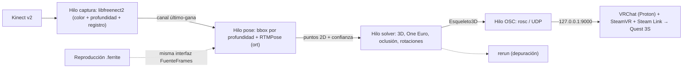

# FerriteVR

[](LICENSE-MIT)
[](#requisitos-del-sistema)
[-brown.svg)](Cargo.toml)

Sistema de seguimiento de cuerpo completo (*Full Body Tracking* o FBT) nativo para Linux escrito en **Rust**. Convierte un sensor **Kinect v2 (Xbox One)** en trackers de cuerpo completo para **VRChat** emitiendo mensajes mediante el protocolo **OSC** sobre UDP.

Diseñado para baja latencia (< 25 ms de captura a OSC) y optimizado para entornos de realidad virtual inalámbricos (como Meta Quest 3S vía Steam Link en Nobara Linux).

---

## Características principales

- **Rendimiento nativo en Linux:** Implementado en Rust con el pipeline de captura sobre `libfreenect2` sin capas de emulación intermedias.
- **Enfoque híbrido 2D + Profundidad:** Estimación de pose 2D rápida y precisa mediante **RTMPose Halpe26** (licencia permisiva Apache-2.0) combinada con la nube de profundidad Time-of-Flight (ToF) del Kinect v2 para una elevación 3D robusta.
- **Arquitectura de baja latencia con canales último-gana:** Si una etapa del pipeline se retrasa, descarta fotogramas antiguos en vez de acumular latencia, manteniendo siempre los datos más recientes en VR.
- **Integración directa con VRChat (OSC):** Envía paquetes atómicos (*bundles*) a `/tracking/trackers/...` con posiciones y rotaciones coherentes para cadera, pies, rodillas, codos y pecho.
- **Sin dependencias restrictivas:** Cumplimiento de licencias permisivas (prohibido código AGPL como Ultralytics YOLO).
- **Código y documentación en español:** Toda la base de código, comentarios, rustdoc y especificaciones técnicas están desarrollados íntegramente en español.

---

## Arquitectura del sistema



---

## Estructura del repositorio

```
FerriteVR/
├── Cargo.toml                    # Configuración del workspace de Cargo
├── README.md                     # Descripción general del proyecto
├── CHANGELOG.md                  # Registro de cambios (Keep a Changelog)
├── CONTRIBUTING.md               # Guía de contribución y flujo de trabajo
├── LICENSE-MIT                   # Licencia MIT
├── LICENSE-APACHE                # Licencia Apache 2.0
├── .editorconfig                 # Configuración de estilo de editores
├── .gitignore                    # Reglas de exclusión de Git
├── docs/                         # Documentación organizada bajo Diátaxis
│   ├── README.md                 # Índice de documentación
│   ├── tutoriales/               # Guías paso a paso para principiantes
│   ├── guias/                    # Recetas prácticas para tareas concretas
│   ├── referencia/               # Especificaciones técnicas y formatos
│   ├── explicacion/              # Arquitectura, solver y diseño conceptual
│   └── adr/                      # Registro de Decisiones de Arquitectura (MADR)
├── crates/                       # Librerías internas del workspace
│   ├── ferrite-nucleo/           # Tipos comunes, articulaciones y espacios de coordenadas
│   ├── ferrite-osc/              # Emisor de paquetes OSC para VRChat
│   ├── ferrite-sensor/           # Abstracción FuenteFrames, grabaciones y Kinect
│   ├── ferrite-freenect2-sys/    # Puente C++/Rust con libfreenect2 (FFI)
│   ├── ferrite-pose/             # Inferencia de modelos ONNX (ort)
│   └── ferrite-solver/           # Reconstrucción 3D, filtros temporales y cinemática
└── apps/
    └── ferrite/                  # Binario ejecutable de línea de comandos (CLI)
```

---

## Requisitos del sistema

### Hardware
- **Sensor:** Kinect v2 para Xbox One con adaptador de corriente y conector USB 3.0 (enlace a 5 Gbps requerido).
- **Visor VR:** Meta Quest 3S (o similar) conectado mediante Steam Link a SteamVR.
- **Equipo anfitrión:** CPU multinúcleo moderna y GPU compatible (validado con Intel Core Ultra 5 225F y NVIDIA GeForce RTX 3060 12 GB). Conexión Ethernet gigabit recomendada.

### Software
- **Sistema operativo:** Linux x86_64 (validado en Nobara Linux 44 sobre KDE Wayland).
- **Compilador:** Rust 1.85 o superior (edición 2024).
- **Librerías del sistema:** `libfreenect2`, `libusb-1.0`, `turbojpeg`, `OpenCL` u `OpenGL`.

---

## Documentación y guías

Consulta [`docs/README.md`](docs/README.md) para acceder al índice completo de documentación, organizado en:
- **Tutoriales:** Primeros pasos con modo sintético y calibración en VRChat.
- **Guías:** Compilación de dependencias nativas y configuración de aceleración por hardware.
- **Referencia:** Parámetros de configuración, direcciones OSC y especificaciones de archivos de grabación.
- **Decisiones de Arquitectura (ADR):** Registro formal de decisiones técnicas en [`docs/adr/`](docs/adr/).

---

## Contribución

Agradecemos las contribuciones a FerriteVR. Antes de comenzar, por favor lee nuestra [Guía de contribución](CONTRIBUTING.md) para conocer las convenciones de código, flujo de ramas Git y requisitos de verificación de calidad.

---

## Licencia

Este proyecto está distribuido bajo licencia dual:
- [Licencia MIT](LICENSE-MIT)
- [Licencia Apache 2.0](LICENSE-APACHE)

Puedes elegir cualquiera de las dos licencias a tu conveniencia.
