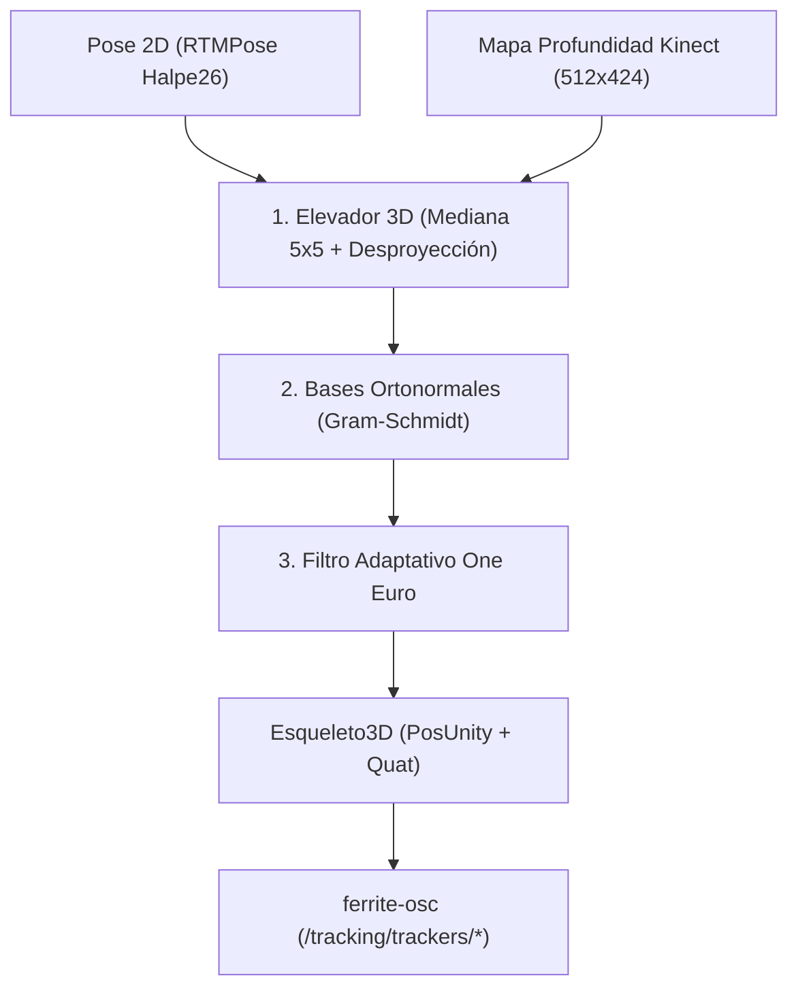

# Arquitectura y funcionamiento del solver cinemático 3D

El solver cinemático (`crates/ferrite-solver`) es el módulo central de **FerriteVR** encargado de transformar las estimaciones bidimensionales de pose (producidas por `ferrite-pose`) y la matriz de profundidad cruda (entregada por `ferrite-sensor`) en un esqueleto tridimensional continuo, anatómicamente coherente y suavizado temporalmente para VRChat.

---

## 1. Flujo del pipeline cinemático

El solver se ejecuta en cada ciclo en < 1 ms, sin realizar asignaciones de memoria dinámicas en el montículo.

---

## 2. Elevación 3D y muestreo por mediana

Para cada punto clave 2D $(u, v)$ detectado por la red neuronal, es necesario obtener su distancia ortogonal al sensor en milímetros.

### ¿Por qué ventana de mediana $5 \times 5$?
En sensores de tiempo de vuelo (*Time-of-Flight*) como el Kinect v2, los bordes de la silueta humana sufren de dos tipos de artefactos:
1. **Píxeles mixtos o ruido volador (*flying pixels*):** Rayos infrarrojos reflejados parcialmente entre el cuerpo y el fondo generan valores flotantes erróneos.
2. **Pérdida de medición (NaN o ceros):** Superficies oblicuas no retornan señal.

El `Elevador3D` muestrea una vecindad cuadrada de radio $R=2$ ($5 \times 5 = 25$ píxeles), filtra las distancias fuera de rango ($< 500$ mm o $> 4500$ mm) y calcula la **mediana estadística**. Esto descarta automáticamente los valores atípicos de ruido y garantiza que la profundidad seleccionada corresponda firmemente a la superficie del cuerpo humano.

### Desproyección estenopeica:
A partir de los parámetros intrínsecos de la cámara ($f_x, f_y, c_x, c_y$):

$$Z_m = \frac{z_{\text{med}}}{1000}$$

$$X_m = \frac{(u - c_x) \cdot Z_m}{f_x}, \quad Y_m = -\frac{(v - c_y) \cdot Z_m}{f_y}$$

El punto resultante se expresa en el espacio diestro de la cámara [`PosKinect`](file:///home/crivera/proyectos/FerriteVR/crates/ferrite-nucleo/src/lib.rs) y se transforma de inmediato al espacio métrico siniestro de Unity [`PosUnity`](file:///home/crivera/proyectos/FerriteVR/crates/ferrite-nucleo/src/lib.rs) invirtiendo el signo del eje $Z$.

---

## 3. Filtrado adaptativo One Euro (1€ Filter)

Para que el seguimiento sea inmersivo en VRChat, debe satisfacer dos requisitos contradictorios:
1. **Cero temblor (*jitter*) en reposo:** Al estar de pie o posando quieto, las articulaciones del avatar deben permanecer perfectamente inmóviles.
2. **Cero retardo (*latency*) en movimiento:** Al caminar, bailar o patear, las articulaciones deben reaccionar al instante (< 1 fotograma de desfase).

Los filtros lineales clásicos (como medias móviles o Butterworth) introducen un retraso inaceptable para lograr suavizado. FerriteVR implementa el **Filtro One Euro** (*Casiez et al., CHI 2012*), cuya frecuencia de corte $f_c$ se adapta en tiempo real a la velocidad estimada de cada articulación:

$$f_c = f_{c,\min} + \beta \cdot |\dot{x}_{\text{filtrada}}|$$

$$\alpha = \frac{1}{1 + \frac{1}{2\pi f_c \Delta t}}$$

$$\hat{x}_t = \alpha \cdot x_t + (1 - \alpha) \cdot \hat{x}_{t-1}$$

### Parámetros optimizados en FerriteVR:
- **$f_{c,\min} = 1.0$ Hz:** Frecuencia baja cuando la velocidad es nula. En reposo, reduce el temblor en más de un **99%**.
- **$\beta = 0.05$:** Coeficiente de velocidad. Ante saltos o movimientos rápidos, $f_c$ aumenta drásticamente, alcanzando más del 70% del cambio en solo 1 fotograma adicional ($\approx 33$ ms a 30 FPS).
- **Filtrado angular esférico (SLERP):** Para las orientaciones representadas por cuaterniones [`Quat`], se aplica una interpolación esférica ponderada por el mismo factor $\alpha$ calculado sobre la velocidad angular en radianes por segundo.

---

## 4. Cálculo de rotaciones anatómicas y bases ortonormales

VRChat soporta tanto posición como orientación en las ranuras `/tracking/trackers/*`. Orientar adecuadamente la cadera y los pies es vital para que las piernas y la pelvis del avatar adopten posturas naturales al sentarse, girar o doblar los tobillos.

El módulo [`rotaciones`](file:///home/crivera/proyectos/FerriteVR/crates/ferrite-solver/src/rotaciones.rs) genera matrices de rotación $3 \times 3$ mediante el proceso de ortonormalización de Gram-Schmidt:

1. **Cadera (`Articulacion::Cadera`):**
   - Eje lateral horizontal: $\vec{X} = \text{CaderaDer} - \text{CaderaIzq}$.
   - Eje vertical superior: $\vec{Y} = \text{Cuello} - \text{Pelvis}$.
   - Eje frontal hacia adelante: $\vec{Z} = \vec{X} \times \vec{Y}$.
   - Se construye una base ortonormal $\mathbf{R} = [\vec{x}, \vec{y}, \vec{z}]$ y se convierte a cuaternión unitario [`Quat`].
2. **Pies (`Articulacion::PieIzq`, `Articulacion::PieDer`):**
   - Eje longitudinal frontal: $\vec{Z} = \text{Dedos} - \text{Talón}$.
   - Eje vertical tibial: $\vec{Y} = \text{Rodilla} - \text{Tobillo}$.
   - Eje transversal: $\vec{X} = \vec{Y} \times \vec{Z}$.
3. **Casos degenerados:** Si los vectores son colineales o nulos (ej. articulación oculta), el solver retorna de forma determinista la identidad [`Quat::IDENTITY`], impidiendo la aparición de `NaN` en los paquetes OSC.
